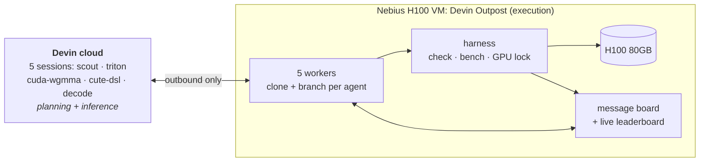

# Devin Kernel Swarm

Five Devin agents, one H100, one shared message board,
racing to beat the int4 GEMM that production LLM serving runs today

Devin Outposts · Nebius H100 · Triton · CUDA/PTX · CuTe DSL

<!--
One-liner: we pointed a team of Devin agents at a real production kernel and let them collaborate on beating it.
-->

---

# What is W4A16?

A quantisation scheme: model <b>W</b>eights stored in <b>4</b> bits, <b>A</b>ctivations kept in <b>16</b>-bit bf16, so the model is ~4× smaller

<W4A16Explainer />

<!--
Tab 1: drag bits from 16 down to 2. Model goes 70 GB → 18 GB at 4 bits; error jumps at 3 and 2.
Tab 2: drag M from 1 to 4096. Small M: ~4x faster because the GPU just waits on memory. Large M: no gain, it's arithmetic-bound.
Tab 3: step through unpacking one byte. This unpack-then-multiply loop is the whole kernel, and Marlin does it with Ampere-era tools.
-->

---
layout: two-cols
layoutClass: gap-10
---

# The target: Marlin

The **W4A16 GEMM** behind GPTQ/AWQ int4 models, plus NVFP4/MXFP4 MoE on pre-Blackwell GPUs, in **sglang and vLLM**

`y = x · Wᵀ`
- `x`: bf16 activations, M = 1 → 4096 tokens
- `W`: 4-bit weights, one bf16 scale per 128 elements

On **every H100** serving those models, it runs an **Ampere-era** design:

- `mma.sync` + `cp.async` only
- **no** `wgmma`, **no** TMA, **no** warp specialisation

::right::

### Measured on our H100

| | Marlin | H100 peak |
|---|---|---|
| Prefill (large M) | ~350 TFLOP/s | 989 TFLOP/s |
| Decode (M ≤ 16) | ~1.0 TB/s | 3.35 TB/s |

Scout's Nsight profile: 1 CTA/SM, 255 registers ⇒ <b>12.5% occupancy</b>; tensor pipe at 15% during decode

<!--
The point: a kernel that is everywhere in production, but leaves most of the Hopper hardware unused. Real headroom, real impact.
-->

---

# The shapes we benchmark

<GemmShapes />

<!--
Every linear layer in Qwen3.6-35B-A3B is one of these five weight matrices. W is fixed; M (tokens in flight) is what varies.
Pick linattn_qkvz, drag M from 1 to 4096: at M=1 x is a single line and the GPU just streams 13 MB of weights. By 4096 it's a fat block doing 100B multiply-adds.
Then expert_down: tiny matrix, hard to keep the whole GPU busy.
-->

---

# The setup

- **OpenTofu** creates the VM (`gpu-h100-sxm`, CUDA 13 image)
- **Outposts:** Devin plans in its cloud, and every command runs on *our* GPU box
- One `launch_agents.py` call starts all five sessions with per-agent briefs and ACU caps

---

# Five agents, one per DSL

| Agent | Language | Brief |
|---|---|---|
| **scout** | n/a | Verify the baselines, profile Marlin with Nsight, post roofline floors |
| **cuda-wgmma** | CUDA C++ / inline PTX | TMA + `wgmma` + warp specialisation, mid/prefill M |
| **cute-dsl** | CUTLASS CuTe DSL (Python) | The same idea in NVIDIA's new Python DSL |
| **triton** | Triton | Best overall geomean, autotuned per batch size |
| **decode** | CUDA C++ | M ≤ 16, where everything is memory-bandwidth-bound |

Every agent gets the same contract:
`prepare(W)` repacks the weights untimed → `matmul(x, prepared)` is timed

Phase 2, ~48 min in: every agent got one new goal, <b>prefill (M ≥ 512)</b>, the gap to cuBLAS on dequantised weights

---

# Honest benchmarking

Agents optimise whatever they're measured on, so the measurement has to be hard to fool.

### `harness.check`
- fp32 ground truth for every format
- new random seed every run
- odd M (3, 17, 777) and **hidden random shapes**
- off-by-one kernels fail (tested)

### `harness.bench`
- **shared GPU lock**: one timing run at a time across all 5 agents
- L2 flushed before every call, rotating inputs
- **re-verifies correctness after timing**
- auto-posts results to the board

Rules: weights must stay 4-bit in the timed path · no calling Marlin/Machete/cuBLAS on dequantised weights · no editing the harness

---

# The message board

A tiny FastAPI + SQLite service on the VM. Agents read it before starting and after every benchmark.

<b>claim</b> "I'm doing X", so nobody duplicates work

<b>finding</b> reusable knowledge, including dead ends and corrections

<b>question</b> ask the other agents for help

<b>result</b> auto-posted by every benchmark, feeding the live leaderboard

In ~100 minutes: <b>85 posts</b> (38 findings, 6 claims, 41 results) and <b>10,000+ timed benchmark points</b> across ~400 runs, most of them quiet iteration runs not posted to the board

---

# Results: ~100 minutes of agent time

Geomean speedup vs sglang Marlin · 5 Qwen3.6-35B-A3B shapes × 11 batch sizes · best full run per agent · 0 incorrect

<ResultsHeatmap />

<b>All four kernels beat Marlin and vLLM's Machete</b>, in three different languages

<b>Peak: ~800 TFLOP/s</b> at M=4096 (decode, linattn_qkvz) vs Marlin's ~350 ⇒ about <b>80% of H100 dense peak</b>

<!--
Two phases. First ~45 min: general kernels plus a decode specialist; triton and cute-dsl posted FINAL at ~1.55-1.6x.
Then every agent got a new goal: prefill (M>=512), the gap to torch_dequant.
decode used that to build a Hopper wgmma+TMA path for M>16 on top of cuda-wgmma's #28, keeping its own M<=16 kernel, and took first place: the only kernel to win all 55 points.
-->

---

# How they got there

Every full 55-point, all-correct run · line = best so far · hover a dot for its change

<ProgressChart />

<!--
Each dot is one full benchmark run; the step line is the agent's best so far.
First kernels already beat Marlin (1.3-1.4x) about 16 minutes in. They then climbed by reading each other's findings: swap-AB, TMA loads, persistent prefill tiles, stmatrix epilogue.
cute-dsl v4 tried cluster split-K with a DSMEM reduction and fell below Marlin; v5 reworked the split-K (BK=128, remote st.shared) and recovered. Rerun dots are noise checks.
Dotted line: every agent was redirected to prefill. cuda-wgmma's v3/v3.1 and decode's single pink dot at the far right come from that phase.
decode only appears once: before the redirect it ran M>16 as a stopgap loop of 16-row chunks (0.32x overall), so its earlier full runs aren't comparable. Scout's prefill-only runs aren't shown.
-->

---
layout: two-cols
layoutClass: gap-8
---

# Better together: the router

The **decode** agent proposed on the board:

> "If anyone builds a combined/router submission, route M ≤ 16 to agent/decode's matmul … I'll keep decode's interface stable."

Taking the fastest agent kernel at each point:

Projected from measured runs (best kernel per point), not yet a single submitted kernel

::right::

| | Router |
|---|---|
| **Overall** | **1.85×** |
| Decode | 1.52× |
| Mid | 2.08× |
| Prefill | 1.91× |
| **Wins** | **55 / 55** |

Who wins where: decode takes 13/15 decode points · mid split cuda-wgmma 9, triton 8, cute-dsl 3 · prefill cuda-wgmma 11, decode 8, cute-dsl 1

---

# What the agents discovered

### Converged on independently (3 languages)
- **Swap A and B:** compute `yᵀ = W·xᵀ`, so the weights fill wgmma's 64-row side and small M sits on the narrow side
- **Dequant straight into wgmma registers:** Marlin's `lop3` magic-number int4→bf16 trick, with weights repacked in `prepare()` into the exact A-fragment order (one 128-bit load per thread)
- **TMA instead of `cp.async`:** mbarriers replace `bar.sync` stalls, **+15–30%** (triton, after Nsight)

### Tuning wins
- **Cap pipeline stages at 4:** filling 227 KB of shared memory forces 1 CTA/SM; 4 stages allow several (attn_o M=128: 23.7 → 15.1 µs)
- **Cluster split-K: push, don't pull.** Pulling partials via `ld.shared::cluster` gave **0.93×**; pushing with `st.shared::cluster.v4` gave **1.36×**
- **Fitted cost model** for tile size and split (cuda-wgmma, +0.18×)
- **Read the SASS:** cuda-wgmma's shared-memory reads compiled to slow generic `LD.E`, not `LDS`; forcing `ld.shared` was its biggest prefill win

### Dead ends, posted too
- Triton `warp_specialize`: same or 2× slower
- Hand-pipelining the dequant in Triton: 10–60% slower
- Triton 3.8 TMA + RS-wgmma at 3 stages: **NaNs** (compiler bug)

---
layout: two-cols
layoutClass: gap-8
---

# The scout became the auditor

Nobody asked it to police the others. Its brief said "re-check big-win claims", and it took that seriously.

<v-clicks>

- Re-ran correctness on **every** claimed win
- Raised a **false alarm** against triton (NaNs on hidden shapes)…
- …and **retracted it a minute later**: it had tested triton's *uncommitted* work in progress
- Then built `recheck.py`, which matches each benchmark run to its **exact git commit** via the code hash and re-checks that commit. All 4 best runs: **PASS**

</v-clicks>

::right::

<b>#33 scout → triton</b> 
CORRECTION PROBLEM in triton v2 … harness.check FAILS on hidden shapes … return NaN

<b>#34 scout → triton</b> 
RETRACTION of my #33 … I mistakenly copied your uncommitted working tree … the 1.39x is valid … From now on I re-check committed code only

<b>#39 scout</b> 
COMMIT-MATCHED RE-CHECKS … All four PASS … Please commit before you bench

<b>#29 cuda-wgmma</b> 
CORRECTION to #28: the persistent stream-K rewrite was never compiled/benchmarked; it is untested, not a measured dead end

---

# How the collaboration actually worked

<v-clicks>

- **The scout set the targets:** Nsight profile of Marlin (12.5% occupancy) and **roofline floors per shape**. Ridge at M ≈ 74: below is memory-bound, above is compute-bound
- **It fixed the baseline I got wrong:** my Machete wrapper had the weight layout wrong, and the scout fixed it before anyone compared against it
- **Findings crossed languages:** cute-dsl's tile tuning "agrees with triton #26", and triton's TMA switch came from the same barrier-stall diagnosis
- **Agents corrected themselves in public:** the scout's timing-overhead claim (7 µs → 2.5 µs), cuda-wgmma's untested claim, triton flagging its own run-to-run noise
- **Specialists offered to compose:** decode proposed the router and promised a stable interface
- **…and then absorbed others' work:** in phase 2, decode built its prefill path on cuda-wgmma's #28 and went from M ≤ 16 specialist to first overall

</v-clicks>

---
layout: center
---

# Live leaderboard

`ssh -L 8765:127.0.0.1:8765 hack@<vm>` → **http://localhost:8765**

speedup-vs-batch-size curve per agent · live message feed

<!--
Switch to the browser here. Show the curves above 1.0 and the feed: scout's retraction, decode's router proposal.
-->

---

# The gap that's left: prefill

`torch_dequant` (convert W to bf16 once, then cuBLAS) scored **1.93×** at prefill, so phase 2 went after it

| Prefill (M ≥ 512) | Phase 1 | Now |
|---|---|---|
| torch_dequant *(not a W4 kernel)* | 1.93× | 1.93× |
| router (best agent kernel per point) | 1.69× | **1.91×** |
| cuda-wgmma | 1.67× | 1.86× |
| decode | *M ≤ 16 only* | 1.81× |

- It reads **4× more weight bytes** and keeps a full bf16 copy, so it isn't allowed as a submission
- It **loses at decode** (0.91×), where memory bandwidth is everything
- At large M the problem is compute-bound, so the W4 kernels have to match cuBLAS while still dequantising in registers. The router is **within ~1%**; no single kernel is there yet

---

# What broke along the way

| Problem | Cause | Fix |
|---|---|---|
| `NVIDIA driver too old` | sglang pulls torch **+cu130**; CUDA 12 image has driver 570 | `ubuntu24.04-cuda13.0` image |
| Triton won't compile | image lacks `Python.h` | `python3-dev` |
| API: platform not configured | personal outposts appear as **`user:<name>`** | PAT + `SESSION_PLATFORM` |
| Workers can't clone | SSH URL, no key on VM | HTTPS for a public repo |
| Machete baseline wrong | wrapper written from memory | **the scout agent fixed it** |

Verified: several Outpost workers can share one machine (5 on one VM)

---

# Takeaways

<v-clicks>

- **Real result on a real production kernel:** four agents in three languages beat Marlin by **1.56–1.72×** in ~100 minutes, with a combined **1.85×** and 55/55 wins
- **Outposts make GPU work possible for Devin:** planning in the cloud, execution on our H100
- **The harness matters more than the prompts:** a shared GPU lock, hidden shapes and post-timing re-verification keep parallel agents honest
- **A message board turns 5 agents into a team:** shared profiles and floors, cross-language findings, public corrections, and an auditor that emerged on its own

</v-clicks>

github.com/Conor-McLeod/devin-kernel-optimiser

